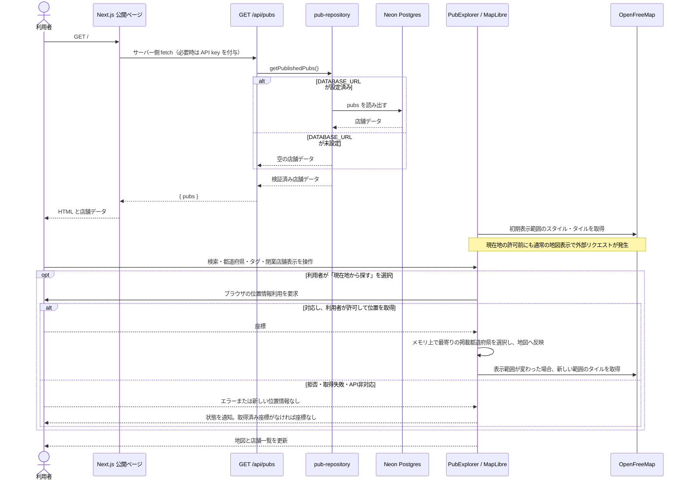
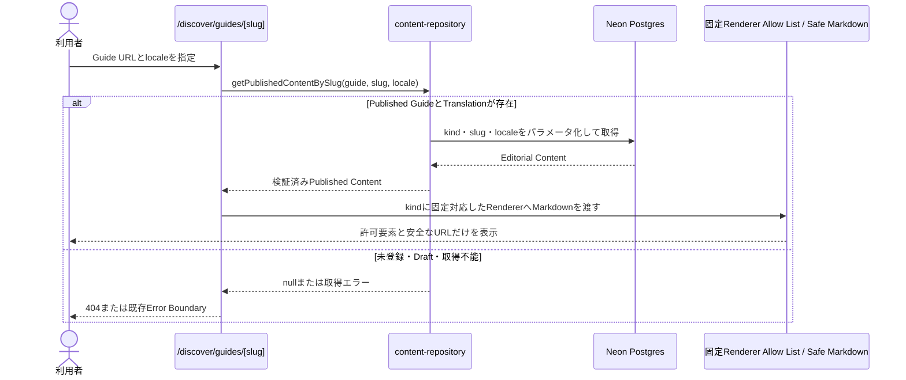
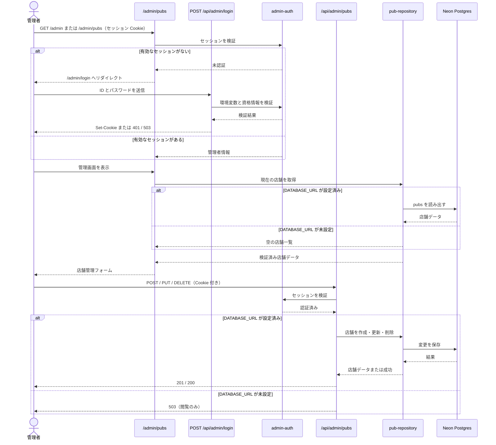
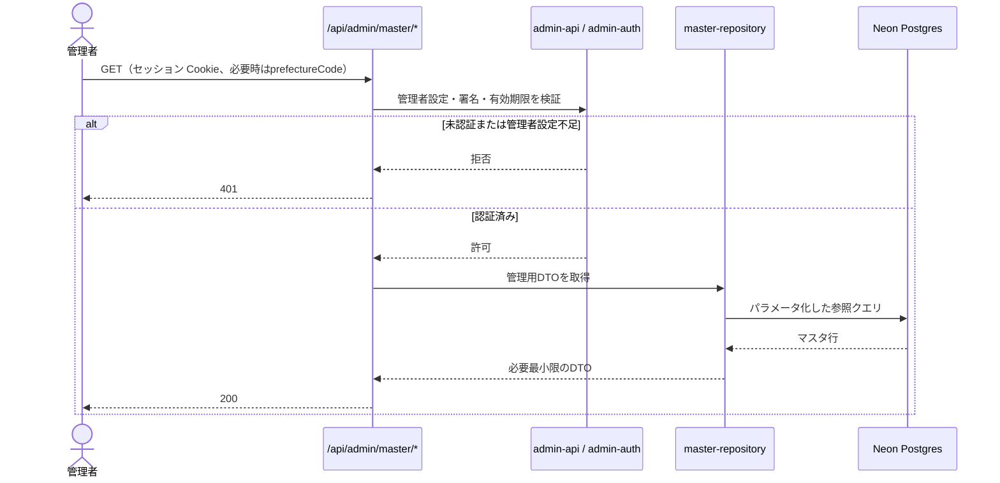

# シーケンス図

## 公開画面で店舗を表示する

初期地図は位置情報の許可に関係なくスタイルと表示範囲のタイルをOpenFreeMapから取得します。位置情報は初回表示時に要求しません。取得した座標はReactのメモリ上で利用し、アプリのAPI、Neon、Cookie、Local Storageへ送信・保存しません。再取得が失敗しても既存の座標を消去しないため、以前取得した座標があればページ内に残り続けます。ページ終了または再読み込みで破棄します。現在地への地図移動後は新しい表示範囲のタイル要求が発生する場合があり、要求URLからおおよその閲覧地域を推測できる可能性があります。ブラウザ/OSが位置を特定するために行う処理はアプリから確認できません。詳細は[外部送信・プライバシー実態整理](../operations/privacy-and-external-transmission.md)と[地図プロバイダー利用方針](../operations/map-provider.md)を参照してください。

VercelのPreview Deployment Protectionが公開APIのサーバー側fetchをSSOへリダイレクトした場合、公開ページは静的データを複製せず店舗0件で表示します。実データを表示するにはSSO回避用の設定とDATABASE_URLを構成します。WebGLを初期化できないブラウザでは、地図の代わりに店舗一覧を案内します。

## 公開Guideを表示する

公開Guide / StoryはNeon Postgresを唯一のSource of Truthとし、許可要素・安全なURLに限定したMarkdown Rendererで表示します。Repository内の静的コンテンツへfallbackしません。Renderer選択はApplication側の固定Allow Listを使用し、DB値からComponent名やmodule pathを解決しません。

## 管理者が店舗を追加・更新・削除する

管理 API のリクエストとレスポンス、HTTP ステータスの詳細は[API 方針](../specs/api.md)を参照してください。

## 管理画面が参照マスタを取得する

